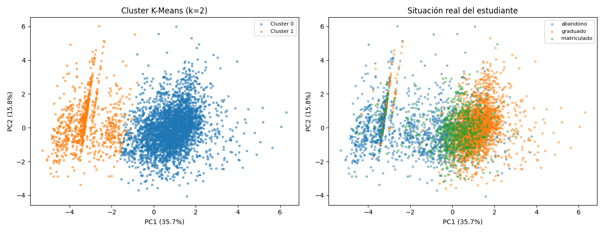
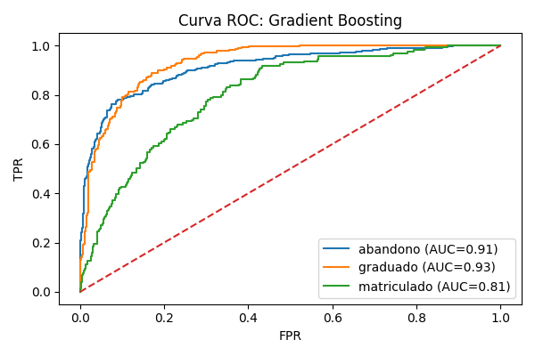
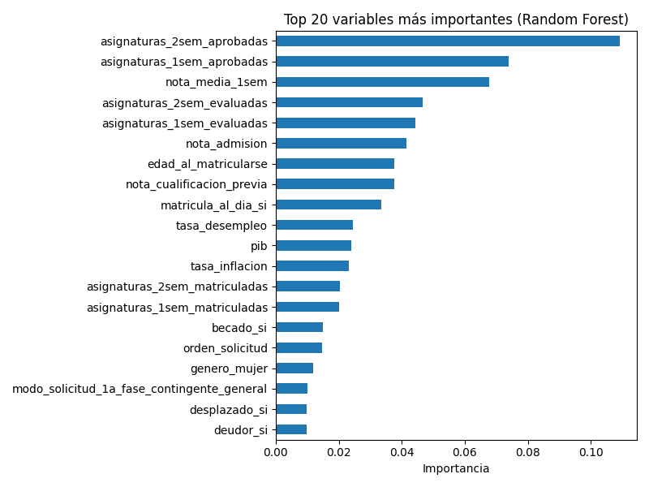
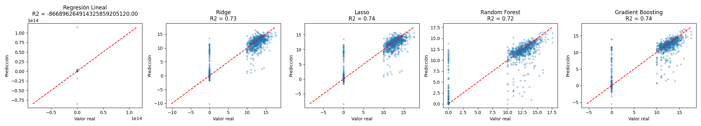

# Predicting Student Dropout & Academic Success

🇪🇸 [Versión en español e instrucciones originales del proyecto → README_ES.md](README_ES.md)

End-to-end machine learning study on **4,424 higher-education students** to understand what drives dropout and academic success, and whether it can be anticipated early enough to act on.

Three complementary tasks on the same dataset:

| Task | Question | Best model | Result |
|---|---|---|---|
| **Classification** | Will the student drop out, stay enrolled or graduate? | Gradient Boosting | **F1-macro 0.69** · AUC 0.91 (dropout) / 0.93 (graduate) |
| **Regression** | What will their 2nd-semester average grade be, using only prior information? | Gradient Boosting | **R² 0.74** · RMSE 2.63 (0–20 scale) |
| **Clustering** | Are there distinct student profiles? | GMM (k=3) | Silhouette 0.32 · a clear **at-risk profile with 80% dropout** |

> Final project for *Machine Learning* (2nd year, Mathematical Engineering & AI — Universidad Pontificia Comillas). Full write-up (NeurIPS format, in Spanish): [`informe/Proyecto_Final_Machine_Learning_Adriana_Lorenzo.pdf`](informe/Proyecto_Final_Machine_Learning_Adriana_Lorenzo.pdf)

---

## Key findings

- **The first semester is an early filter.** 1st-semester passed courses and average grade are the strongest predictors across every model and task. Students who don't consolidate early are far more likely to drop out, so interventions there should have the biggest impact.
- **Financial risk is a separate signal from academic risk.** Tuition up to date, debtor status and scholarship contribute consistently and define the at-risk cluster, which suggests institutions should treat academic and economic risk with different kinds of support.
- **Prior grades matter less than university performance.** Admission grade and previous qualification play a secondary role once 1st-semester data is available.
- **"Enrolled" is hard to predict by nature.** It is a transitional state rather than a profile (F1 0.43–0.47 in every model), so it overlaps with both other classes.
- **Profiles emerge without labels.** K-Means, hierarchical clustering (Ward) and GMM independently converge on the same three groups (at-risk, intermediate, high-performing with scholarship) without using the target.

<p align="center">
  
  <br><em>Unsupervised clusters (left) closely mirror the real outcomes (right), although the target was never used.</em>
</p>

---

## Results

### 1. Classification: final student status (3 classes)

Class imbalance (49.9% graduate / 32.1% dropout / 17.9% enrolled) means **F1-macro** is the main metric, with `class_weight='balanced'` where available.

| Model | Accuracy | F1-macro | F1-weighted |
|---|---|---|---|
| Logistic Regression | 0.735 | 0.686 | 0.743 |
| KNN (k=7, CV-tuned) | 0.603 | 0.478 | 0.566 |
| Random Forest (200 trees) | **0.773** | 0.685 | 0.752 |
| **Gradient Boosting** | 0.764 | **0.690** | **0.755** |

Linear and ensemble models perform almost the same, which points to a performance ceiling set by the data rather than by model capacity. KNN suffers from the curse of dimensionality (237 features after one-hot encoding).

<p align="center">
  
  
</p>

### 2. Regression: 2nd-semester average grade

**No data leakage:** every 2nd-semester variable (enrolled, evaluated, passed, credited and unevaluated courses) is excluded, because it is recorded at the same time as the target. Predictions rely only on admission, demographic, socio-economic and 1st-semester data.

| Model | RMSE | MAE | R² (test) | R² (5-fold CV) |
|---|---|---|---|---|
| Linear Regression | — | — | ≪ 0 (unstable) | — |
| Ridge (α=1) | 2.680 | 1.615 | 0.735 | 0.736 ± 0.035 |
| Lasso (α=0.01) | 2.663 | 1.577 | 0.738 | 0.743 ± 0.036 |
| Random Forest | 2.733 | **1.397** | 0.724 | **0.768 ± 0.045** |
| **Gradient Boosting** | **2.635** | 1.442 | **0.744** | 0.766 ± 0.040 |

Plain OLS breaks down because one-hot dummies cause perfect multicollinearity. It is kept on purpose to motivate Ridge and Lasso. The largest errors are students with a real grade of 0 (19.7% of the target), mostly dropouts who never sat exams.

<p align="center">
  
</p>

### 3. Unsupervised learning: student profiles

10 interpretable, non-redundant variables (grades, passed courses, admission grade, age, tuition status, debtor, scholarship), standardised, with PCA used for visualisation (2 components ≈ 51.5% of variance). k was chosen using the elbow method, silhouette, Dunn index and connectivity.

| Method | k | Silhouette | Dunn |
|---|---|---|---|
| K-Means | 3 | 0.235 | 0.040 |
| AGNES (Ward) | 3 | 0.195 | 0.064 |
| **GMM** | 3 | **0.323** | **0.172** |

| Profile | Description |
|---|---|
| **At-risk** | Near-zero performance in both semesters, older at enrolment, no scholarship · **~80% dropout** |
| **High-performing** | Strong grades, highest scholarship rate · **~85% graduates** |
| **Intermediate** | Largest group, solid performance without financial support |

---

## Repository structure

```
├── data/
│   └── rendimiento_estudiantes.csv   # raw dataset (train/test splits are generated by notebook 02)
├── notebooks/
│   ├── 01_EDA.ipynb                  # exploratory analysis
│   ├── 02_preprocesado.ipynb         # encoding, leakage control, stratified split, scaling
│   ├── 03_clasificacion.ipynb        # LogReg, KNN, RF, GB · confusion matrices, ROC, importance
│   ├── 04_regresion.ipynb            # OLS, Ridge, Lasso, RF, GB · CV, residuals, importance
│   └── 05_clustering.ipynb           # PCA, K-Means, AGNES, GMM · profile analysis
├── figuras/                          # all figures (generated by the notebooks)
├── informe/                          # full report (PDF, Spanish)
└── requirements.txt
```

## How to run

```bash
git clone https://github.com/adrianalorenzo/ML_proyecto_final.git
cd ML_proyecto_final
pip install -r requirements.txt
jupyter notebook
```

Run the notebooks **in numerical order**. `02_preprocesado` is the only notebook that writes to `data/`, and it generates the train/test splits and scalers that notebooks 03–05 read.

**Reproducibility:** every notebook fixes `random_state=42`. The 80/20 split is stratified by class, and scalers are fit on train only. Running the notebooks in order reproduces the results in the report exactly.

## Methodology highlights

- Stratified 80/20 split, with `StandardScaler` fit on train only (no scaling leakage); tree models are trained on unscaled data
- Explicit data-leakage control for the regression target
- Metrics chosen for the problem: F1-macro for imbalanced multiclass, plus per-class ROC-AUC
- Linear vs. non-linear model comparison, regularisation (L1/L2) and 5-fold cross-validation
- Interpretability through RF/GB feature importance and Lasso coefficients
- Cluster validation with 4 internal criteria, checked across 3 algorithm families

## Limitations & next steps

- **Correlation ≠ causation.** The findings describe associations; any institutional intervention would need further validation.
- **Single institution** (Portugal), so generalisation to other contexts is limited.
- The classification task uses information up to the 2nd semester, as the assignment defined it. A true **early-warning model** using only enrolment and 1st-semester data is the natural next step.
- Planned: SHAP explanations, hyperparameter tuning, a two-stage model for the zero-inflated grade target, and an interactive Streamlit demo.

## Data

*Predict Students' Dropout and Academic Success*: Realinho, V., Vieira Martins, M., Machado, J. & Baptista, L. (2021). [UCI Machine Learning Repository](https://archive.ics.uci.edu/dataset/697/predict+students+dropout+and+academic+success), CC BY 4.0. The version used here has column names and categorical labels translated to Spanish.

## Tech stack

Python · pandas · NumPy · scikit-learn · SciPy · Matplotlib · seaborn · Jupyter

---

**Adriana Lorenzo Mingorance** · Mathematical Engineering & AI, Universidad Pontificia Comillas
